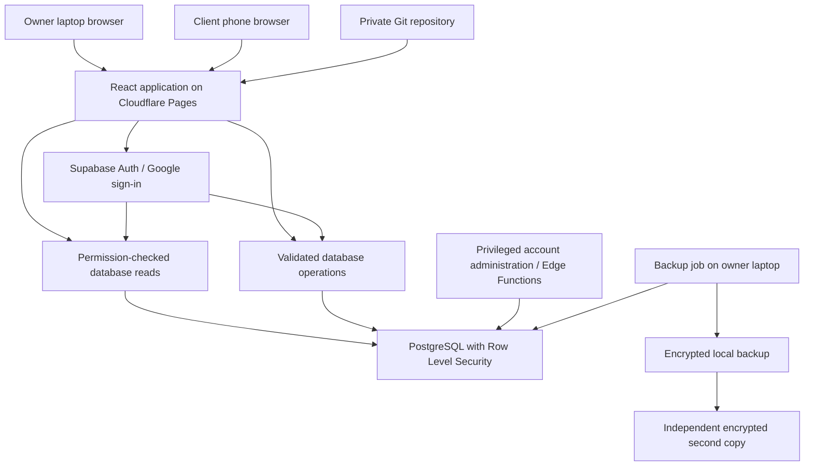

# Velmurugan Finance — application architecture

Prepared 3 November 2026. Design proposal based on Finance_Application_Build_Guide.docx and the client's confirmed requirements. This document defines the build; it does not deploy services or activate billing. Existing index.html is a local demonstration and visual reference, not the production financial engine.

## Latest client decisions — supersede conflicting proposals below

- Launch with tens of clients and exactly one financer account. No staff access initially.
- Financer assigns each loan's interest rate based on the amount; no automatic amount-to-rate schedule is assumed.
- Clients use a financer-created customer ID and financer-set password. Client Google accounts are not required. No public self-registration or self-linking.
- Financer requests Gmail address/password followed by a verification code to that email. Clarify whether password means an application password for the Gmail address or Google sign-in on Google's page. Never collect the actual Google account password in this application.
- Email OTP as a second step is a custom server-enforced design, not Supabase's built-in MFA (which documents TOTP and phone factors). Production email delivery requires SMTP/service configuration. A password session alone must have no financial or wallet access: enforce a short-lived, session-bound, server-issued email-verification grant in every owner policy/function. Codes expire, have attempt/resend limits, are stored hashed, and are invalidated after use. Bind challenges to the verified password session and fixed owner email; prevent another ordinary OTP login from satisfying this grant. Owner recovery and email-provider failure procedures need definition.
- Supabase's password API accepts email/phone, not arbitrary usernames directly. Implement customer-ID login through a rate-limited backend adapter to a private, unique Auth identity mapping. Do not publish identity mappings or create a separate homemade password verifier. Use Supabase Auth password validation, generic login errors and server-verified client linkage. A backend-created non-deliverable internal email alias can identify accounts when clients lack email; document and test disabled email confirmation, no public signup, and owner-mediated recovery. Never direct client recovery mail to aliases. Preserve the Supabase user identity and RLS boundary.
- The owner can provision/reset passwords after elevated verification; resets revoke client sessions as required and are audited. Authentication passwords remain hashes. Recommended credential handover is an initial password shown once, followed by reset rather than later retrieval.

### Separate secret wallet

Owner-only encrypted vault for selected sensitive client details and IDs, unlocked with a separate wallet password after full owner verification. This password is never a frontend hard-coded check. Ordinary account screens and client APIs cannot read vault records.

Use authenticated encryption (AES-GCM with fresh nonces) for records, a randomly generated vault data key, and a wallet-password-derived key to wrap it using a reviewed password KDF and stored salt/parameters. Decrypt only while unlocked, keep keys in memory and lock on inactivity/logout. Do not store plaintext, keys or the wallet password in localStorage, logs, exports or analytics. Use owner-only RLS even for ciphertext. Define tables vault_items (client, ciphertext, nonce, version) and vault_key_metadata (wrapped key, salt, KDF parameters); audit access metadata without secret values.

Retrievable client passwords in the vault remain a requested design decision, not an approved implementation default. If explicitly required, store a separately encrypted copy only in this vault, never in authentication/profile tables; coordinate resets so old copies are not displayed as current. Explain the increased exposure and confirm whether the client may later change their password. Safer default: retain IDs and sensitive notes, provide owner reset instead of password retrieval.

Encrypted vault backups must include key metadata and a separately protected recovery-key arrangement. A lost wallet password cannot recover encrypted contents without that recovery mechanism. Password changes rewrap the data key; recovery and rotation require tests. Restrict sensitive-content previews and clear rendered plaintext when locked. Select the specific fields, lock timeout and recovery custodian before implementation.

Remaining owner inputs: clarify application-password versus Google OAuth login; approve production email provider; decide reset-only versus retrievable client passwords; list wallet fields and recovery policy; confirm remaining interest/partial-period rules, opening balances and backup ownership.

## 1. Scope and system layout

One finance business, one owner initially, a few hundred clients as a planning assumption. Responsive English interface; Tamil support requires confirmation. Manual loan disbursement and payment entry. Clients view their records and ask private questions. No payment gateway, SMS, WhatsApp automation, document uploads or offline financial writes in version one.

The website and database remain accessible when the laptop is off, subject to provider availability. Only the proposed laptop backup job depends on the laptop being on. Production data lives in PostgreSQL, never in localStorage. The browser displays confirmed server results.

## 2. Technology and deployment boundaries

| Layer | Decision | Responsibility |
|---|---|---|
| Interface | React, TypeScript, Vite | Separate owner/client routes; reusable accessible components |
| Hosting | Cloudflare Pages, provider subdomain | Static application, HTTPS, SPA route fallback |
| Authentication | Supabase Auth with Google OAuth | Identity and session management |
| Database | Supabase PostgreSQL | Authoritative financial records and exact decimal calculations |
| Authorisation | RLS plus checks inside functions | Active account, role, client ownership |
| Financial operations | Transactional PostgreSQL functions | Loan creation, interest posting, receipts, allocation, corrections |
| Privileged identity operations | Supabase Edge Functions where Auth administration is required | Server-only secrets; explicitly verify owner role |
| Source and release | Private Git repository | Migrations, tests, reproducible build and rollback |
| Backup | Scheduled laptop job plus independent encrypted copy | Export, retention, verification and restore testing |

Prefer SQL functions for atomic ledger changes. An Edge Function must not implement a financial transaction through several independent database requests. The UI may use only the Supabase URL and publishable key. OAuth client secrets and database/service credentials stay outside frontend bundles and Git.

Use synthetic local data for development. Preview deployments must use a non-production backend or have writes disabled. Production release uses a reviewed commit and migrations. Configure Google callback URLs, Supabase site/redirect URLs and Cloudflare SPA routing for the actual address. Publish the Google OAuth application for the intended audience before pilot; a testing-only OAuth setup is not general public access.

## 3. Screens and navigation

Public: branded moving-globe landing page, sign-in, privacy/support information, access-pending screen. Preserve the purple design and motion controls. Lazy-load the large original video; keep a lightweight animated fallback. The video is decorative and must never delay login or account access. Confirm rights to the external asset before launch. Its current size exceeds Cloudflare Pages' individual asset limit, so do not assume it can be copied directly into the deployment.

Owner: dashboard; paginated clients; client detail with loans and private owner notes; create/link/disable client access; give money/new loan; get money/record payment; receipt and statement; correction history; queries inbox/thread; reports; settings and backup status.

Client: My account; loan details and terms; payments/receipts; ask a question; own question threads; profile/access help. Display principal, unpaid posted interest, next interest estimate, due date, total outstanding and last-refreshed time distinctly. A loan without a principal repayment schedule must not label all outstanding capital as due this month.

Show loading, empty, stale, access-denied and failure states explicitly. Failed reads never become zero balances; failed writes never produce success receipts. Clear account data and query caches on logout/account switch. No offline account-data cache or service worker caching of financial responses in version one.

## 4. Data model

Internal keys are UUIDs; customer IDs and receipt numbers are separate unique business identifiers. Monetary values use numeric(18,2); rates use a defined decimal precision. Dates are business dates in Asia/Kolkata; event timestamps are UTC timestamptz. Foreign keys restrict deletion of records with financial history.

| Table | Important fields and constraints |
|---|---|
| profiles | auth_user_id unique, role, active; user cannot self-edit role/status |
| clients | id, customer_code unique, name, contacts, work, address, status |
| client_access | auth_user_id unique, client_id, verified_by/at, active; owner controlled |
| client_private_notes | client_id, owner-only notes; not mixed with client-visible data |
| loans | client_id, code unique, amount, disbursed_on, first_due_on, status, terms_version |
| loan_terms | loan_id, effective date, monthly rate, calculation method, rounding, due and partial-period rules; versioned |
| interest_charges | loan_id, period start/end, due_on, basis, rate snapshot, amount; unique loan/period/type |
| payments | loan_id, amount, paid_on, method, reference, receipt_no unique, request_id unique, payload fingerprint, actor |
| payment_allocations | payment_id, component, charge_id if interest, amount; nonnegative and reconciled to payment |
| adjustments | linked original event, type, amount, reason, actor, effective date; append-only corrections |
| queries | client_id, optional loan_id belonging to client, subject, status, timestamps |
| query_messages | query_id, author, body, timestamp; same-thread ownership checked |
| audit_events | actor, action, entity, time, request_id, limited before/after metadata |
| import_batches / import_rows | source hash, mapping, validation status, reconciliation totals; owner-only |
| backup_runs | started/completed, outcome, manifest/checksum reference, last verified restore; no secrets or backup contents |

Clients have many loans; loans have many charges/payments; payments have many allocations; clients have many query threads. Index foreign keys and common client/date, loan/date and query/status filters. Derived balance views must respect caller permissions; never expose a view that bypasses RLS unintentionally. A controlled ledger rollup reconciles disbursements, principal allocations, charges, interest allocations and signed adjustments. Cached summaries are disposable, not the source of truth.

## 5. Financial rules and transactional behaviour

Confirmed: owner sets a monthly rate per loan; rates may differ by amount but there is no confirmed automatic rate table. First interest due is the end of the month following disbursement. Payments clear unpaid interest before capital. Multiple loans per client are supported; a top-up is a separate loan unless the owner approves another policy.

Pending decisions: original versus remaining principal; exact treatment of partial months and payments before due date; late penalties/grace periods; compounding; principal repayment schedule; rate amendments; waivers; early payoff; backdated corrections. Do not carry the prototype's assumed month-end calculation into live contracts without approval.

Proposed default for review: simple monthly interest on remaining principal, unpaid interest kept separate, no penalty, oldest due interest first, then principal. Post the due charge before same-day payments. Round each monthly charge to paise using an explicitly tested rounding rule. Reject excess payment instead of silently dropping it. Restrict backdating after later postings; route such corrections through reviewed reversal/reposting.

Worked acceptance example: ₹100,000 on 31 October at 5% → first interest due 30 November. ₹7,000 paid that day clears ₹5,000 interest and ₹2,000 principal. Remaining principal ₹98,000; next whole-month interest ₹4,900 under the proposed reducing-principal rule. A payment before 30 November needs a separately approved expected outcome.

Record-payment operation:
1. Verify authenticated active owner; validate date, amount, loan and method.
2. Look up the idempotency request ID; return the original result for the identical payload and reject reuse with a changed payload.
3. Lock the loan row; all other mutations/postings for that loan take the same lock.
4. Catch up missing due charges in order using unique period keys and agreed historical terms.
5. Recalculate allocation from current posted records; reject overpayment or disallowed backdating.
6. Insert payment, allocations and audit event in one transaction; enforce allocation total equals receipt amount.
7. Commit and return receipt and refreshed balance. Retries after timeouts cannot duplicate the payment.

Interest posting runs in a cloud scheduled job when supported and configured; an idempotent server operation also catches up before owner writes and before returning authoritative account snapshots. Restrict snapshot catch-up to the requesting owner's loans or the linked client's loans. Bound catch-up work and page large batches. A paused database cannot execute scheduled work; recovery must catch up deterministically. Laptops and browser clocks never decide posted charges.

Corrections preserve the original entry and require a reason. A reversal must consider downstream allocations/interest; do not merely subtract a receipt from a current total. Freeze affected loan writes during any controlled reconstruction. Financial records cannot be hard-deleted through normal application workflows.

## 6. Login and access policy

Google sign-in creates an identity with no financial access. The owner verifies the person and links the identity to one client. Never permit a client to claim records by knowing an ID, phone number or email. Bootstrap the first owner through a controlled administrative migration; never grant owner role to the first random signup.

RLS applies to every exposed table. Clients may read their own permitted profile, loans, charges, payments and statements, and create text messages in their own threads. They cannot write finance tables, account mappings, roles or owner notes. Queries' optional loan must belong to the same client. Only the owner can resolve/reopen threads under the chosen workflow.

Every policy/function checks active status, so disabling access blocks an existing session immediately at the data layer. Privileged functions explicitly check auth.uid(), role and scope, use a fixed search_path, narrowly scoped execution grants and safe SQL. Client-selectable roles are never trusted. Audit account links, reversals and permission changes. Rate-limit and length-limit questions; render messages as plain text. Avoid sensitive data in application logs.

If Google accounts are unsuitable, add email/password only with production SMTP, verification and recovery. Identity recovery/account relinking requires owner verification and audit history. The financer owns provider accounts and recovery methods; enable MFA and remove developer access when no longer needed.

## 7. API operation contract

Reads: get_my_account_snapshot, get_client_detail, list_clients, list_loan_transactions, list_queries, get_statement. All enforce scope and paginate; sort financial entries deterministically.

Owner mutations: create_client, create_loan, record_payment, request/review_correction, link_client_identity, set_client_access, resolve_query. Identity administration uses a privileged backend only where necessary. Message operations validate thread ownership and author identity server-side.

Return typed errors for unauthorised access, disabled account, stale terms, invalid date, overpayment and retryable failure. Mutation responses contain server receipt IDs and authoritative amounts. UI allocation previews are advisory and should display any changed server allocation before final confirmation where appropriate.

## 8. Refresh, usage and availability

Refresh after confirmed writes, on reopening the account and through a manual button. Initial version needs no continuous polling or realtime subscription. Use 20–50 records per page, server-side filtering and targeted fields. Produce statements on demand rather than storing repeated PDFs. Text-only queries and no ID uploads keep storage low.

Design for a free-plan launch, not a guarantee of years of zero cost or uninterrupted availability. Review database, transfer, function and build allowances before deployment and monthly. Warn internally at approximately 60–70% capacity; estimate remaining capacity from measured pilot growth. Retain financial history even if migration or a paid plan becomes necessary. The original guide's quota table is a dated planning reference, not a permanent service contract.

## 9. Backup, recovery and operations

After each day with changes: run an encrypted database export from the laptop and transfer an encrypted second copy to an owner-chosen independent destination. Run before imports/migrations too. Capture manifest, checksum, completion/error and freshness. If the laptop is off, display overdue backup status; choose another runner if this is unacceptable. Never call an attempted or empty export a successful backup.

Backup scope includes application data, schema/functions/policies/indexes, supported Auth export and account links, source/migrations, and separately secured configuration/secrets. Test managed Auth restoration explicitly. Uploaded objects need their own backup if later introduced. CSV exports are not system backups.

Proposed retention for owner approval: 14 daily and 12 monthly encrypted copies. Weekly verify readability/checksums. Monthly restore into an isolated environment, reconcile record counts/principal/interest/receipts and test login plus cross-client isolation. Store encryption recovery keys separately. Daily backups imply up to a day's data loss; owner must accept or request a tighter recovery point. Recovery-time target is agreed after a timed restore rehearsal, not promised in advance.

Frontend failure: roll back deployment. Data corruption: stop writes, preserve the damaged state, restore separately, reconcile later receipts, test permissions, then switch deliberately. Record who performs recovery and who authorises reopening. Backup failures and provider inactivity notices need a named human recipient.

## 10. Excel migration

Use a staging import, never direct insertion into live balances. Original workbook inspection found continuation rows with omitted identifiers and an invalid date. Owner must resolve ambiguous ownership, dates and rate periods. Choose a cutover date and supply opening principal, already unpaid interest and payment history per loan. Historical original loan amounts alone are insufficient to infer today's balances.

Preserve source hashes and row references; validate IDs, duplicate records, amounts and dates; present an exception list and reconciliation totals. Import approved opening balances as traceable opening events, without reposting historical charges already included. Owner signs off each loan's opening state. Keep the source copy private and outside the published web assets.

## 11. Build sequence and acceptance gates

| Phase | Deliverables | Exit condition |
|---|---|---|
| 1 Rules | Signed loan-rule examples, cutover and scope | Owner approves expected balances |
| 2 Foundation | React structure, local Supabase, migrations, test fixtures | Repeatable local build; no production dependency |
| 3 Security | Google login, pending access, linking and RLS | Direct API cross-client/write tests blocked |
| 4 Ledger | Disbursements, charges, payments, receipts, corrections | Concurrency, retries, rounding and date tests pass |
| 5 Workflows | Owner/client screens, queries, reports and responsive UI | End-to-end role workflows pass |
| 6 Recovery | Backup automation, independent copy, restore runbook | Successful measured restore with correct access |
| 7 Deployment | Owner-owned accounts, production OAuth/Pages configuration | Live login, route, logout and save checks pass |
| 8 Pilot | Approved import and a few verified clients | Owner reconciles balances; clients validate records/questions |
| 9 Handover | Source, runbooks, ownership, monitoring and maintenance | Owner can operate and recover the system |

Required tests include duplicate submit, timeout retry, mismatched idempotency payload, simultaneous payments, overlapping interest jobs, partial/early/full repayment, zero-interest loan, month ends/leap years, rate boundaries, reversal dependencies, overpayment, disabled sessions, wrong-client query access, unlinked signup, failed reads/saves, logout cache clearing and full restoration. Test keyboard access and common phone sizes. Validate globe playback independently from finance correctness.

Suggested repository layout: src/features/auth, clients, loans, payments, queries, reports; src/components and lib; supabase/migrations and functions; tests/finance, permissions and e2e; ops/backup and restore; docs/rules, deployment and handover. Keep the existing prototype as a reference outside the production app bundle.

## 12. What the owner/user needs to do

Before financial implementation:
1. Provide expected clients now and after three years, approximate payments/day, owner/staff count and preferred English/Tamil language.
2. Approve worked examples for interest basis, early/partial payments, unpaid months, penalties, rate changes and corrections. Confirm principal repayment schedule.
3. Confirm all clients can use Google sign-in; identify the owner Google account and how identities will be verified.
4. Select the import cutover date and provide reconciled outstanding principal/unpaid interest, plus corrections to ambiguous Excel rows.

Before deployment:
5. Create or designate owner-owned GitHub, Cloudflare, Supabase and Google Cloud/OAuth accounts. Choose the available Supabase region deliberately before creating production. Developer invitations should be limited to needed access.
6. Select the free site subdomain, business display name, support contact and privacy/data-retention information.
7. Choose encrypted backup destination, responsible person and whether losing changes since yesterday is acceptable. Keep recovery keys privately.
8. Select a few pilot clients and personally approve their identity links and reconciled statements.

We handle application implementation, schema/functions, security policies, configuration instructions, import validation, tests, backup scripts and runbooks. Account ownership, provider sign-ins/consents, business-policy approval and source-balance confirmation must come from the owner. Do not paste passwords, service-role keys, recovery codes or encryption keys into chat or Git.

## Official references

- Cloudflare limits: https://developers.cloudflare.com/pages/platform/limits/
- Supabase Google OAuth: https://supabase.com/docs/guides/auth/social-sign-in/auth-google
- Supabase production email: https://supabase.com/docs/guides/auth/auth-smtp
- Supabase access controls: https://supabase.com/docs/guides/database/secure-data
- Supabase backups: https://supabase.com/docs/guides/platform/backups
- Supabase pricing: https://supabase.com/pricing
- Supabase pausing: https://supabase.com/docs/guides/platform/free-project-pausing
